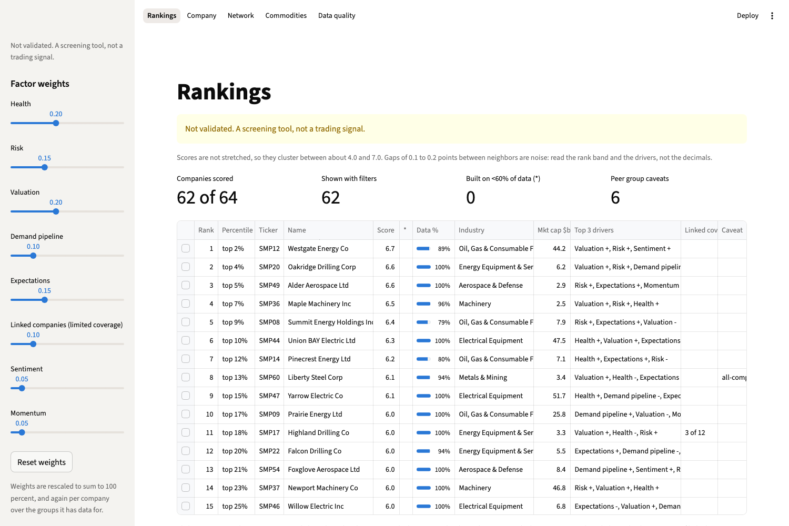

# Energy & Industrials Supply Chain Screener

A Python tool that reads one Excel workbook of Bloomberg data, scores US energy
and industrial companies from 1 to 10 with a transparent method, and shows the
results in an interactive Streamlit dashboard and a printable 4-page PDF report.

> **Not validated. A screening tool, not a trading signal.** It is a current
> snapshot for exploring companies: not a backtest, not a prediction, and not a
> trading system.



## What it does

- **Scores** each company against its industry peers on about 26 metrics in 8
  factor groups: Health, Risk, Valuation, Demand pipeline, Expectations,
  Linked companies, Sentiment and Momentum.
- **Uses the supply chain**: for a set of "core" companies, the scores of their
  Bloomberg-listed suppliers and customers feed a Linked companies group
  (two-pass scoring, so scores never depend on each other in a loop).
- **Explains every score**: how many points each factor group added or took
  away, and plain-English reasons such as *"Cheaper than 95% of Oil, Gas &
  Consumable Fuels peers on price/book (1.1x)."*
- **Flags weak spots**: data completeness on every score, a peer group caveat
  badge (tiny or mismatched peer groups, extreme ratios) and linked coverage.
- **Dashboard pages**: Rankings, Company detail, supply chain Network,
  Commodity sensitivity heatmap and Data quality. Weight sliders rescore live.
- **Report**: top 15 / bottom 5, the core names, why the top 5 score well, and
  method and caveats, in black-and-white-friendly US Letter.

The full method, every factor, its direction and weight: [methodology.md](methodology.md).

## Quick start (no Bloomberg needed)

Needs Python 3.9 or newer. On macOS:

```zsh
git clone https://github.com/robin-ogrady/energy-industrials-screener.git
cd energy-industrials-screener
python3 -m venv .venv
.venv/bin/python -m pip install -r requirements.txt

.venv/bin/python make_sample_data.py           # writes an INVENTED workbook to sample/
export SCREENER_DATA_FILE=sample/sample_workbook.xlsx
.venv/bin/python loader.py                     # parse, cache, print a data check
.venv/bin/streamlit run app.py                 # dashboard in your browser
.venv/bin/python make_report.py                # report.pdf, scores.csv, methodology.md
```

On Windows use `.venv\Scripts\python` and `set SCREENER_DATA_FILE=...`.
Every company and number in the sample is made up by a random number generator.

## Using your own Bloomberg data

1. Build the workbook on a Bloomberg terminal in the layout described in
   **[docs/DATA_FORMAT.md](docs/DATA_FORMAT.md)** (sheet names, headers, field
   mnemonics, the column-group and supply chain block layouts). The generated
   sample is a complete example of that layout.
2. Save a **values-only** copy (Paste Special > Values on every sheet).
3. Put it in the project folder and set `DATA_FILE` in `config.py`, or set
   `SCREENER_DATA_FILE` as above.
4. Run `.venv/bin/python loader.py` and read the data summary. Rows marked
   `CHECK` point at a layout problem. A full data quality report is written to
   `cache/data_quality_report.txt`.
5. Start the dashboard or build the report.

The universe can be any list of tickers (we used about 250 US energy and
industrial names, with 37 core names that have supply chain data).

## Settings

Everything adjustable lives in [`config.py`](config.py), with a comment on
each choice: factor group weights, the metric list and directions, winsorizing
limits, the minimum peer group size, window lengths, link weights by cost
category, the caveat rules and the optional switches:

- `use_capex_intensity` (off by default): adds capex / sales to Demand pipeline.
- `headline_lm_enabled` / `headline_lm_in_score` (off by default): scores
  News-sheet headlines with the Loughran-McDonald word list (downloaded once
  into `cache/`; free for academic use) and optionally adds it to Sentiment.
- `peer_group_caveats`: your own list of companies whose GICS industry is a
  poor comparison group.

The dashboard sidebar overrides the weights and switches for a session; its
"Build PDF report" button uses the current weights and filters.

## Project layout

| File | What it does |
|---|---|
| `config.py` | All settings, including the data file path |
| `loader.py` | Reads the workbook once, cleans it, caches it, prints a data summary |
| `features.py` | Turns clean data into one row of metrics per company |
| `scoring.py` | Percentile ranks, factor groups, two-pass score, explanations |
| `network.py` | Supplier / customer graph and its figure |
| `app.py` | Streamlit dashboard |
| `make_report.py` | PDF report, `scores.csv`, `methodology.md` |
| `make_sample_data.py` | Writes an invented workbook in the exact layout |
| `tests/` | Loader, scoring, report and end-to-end tests (`.venv/bin/python -m pytest -q`) |

## Licensed data

Bloomberg data is licensed. `.gitignore` keeps spreadsheets, CSV and PDF
outputs, the cache and screenshots out of git. Share code and methodology, not
raw exports or outputs built from them. The images in this README come from
the invented sample.

## Known limitations

- A one-day snapshot: no history of scores, no backtest, no evidence that the
  score predicts returns.
- Scores are not stretched, so they cluster near the middle (5.5 = neutral);
  gaps of 0.1 to 0.2 between neighbors are noise.
- Supply chain links are each core company's top 20 only, mostly Bloomberg
  estimates, and often point to companies outside the universe, so the Linked
  companies group has limited coverage.
- Peer groups come from GICS labels; small or mixed industries fall back to the
  sector or to all companies, and are flagged.

## License

MIT, see [LICENSE](LICENSE). Bloomberg data is not covered by this license.
